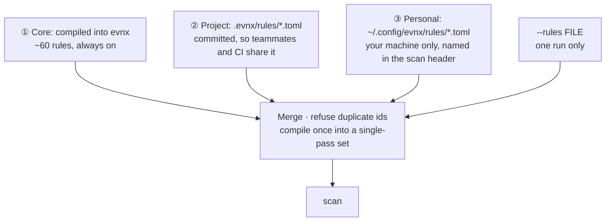
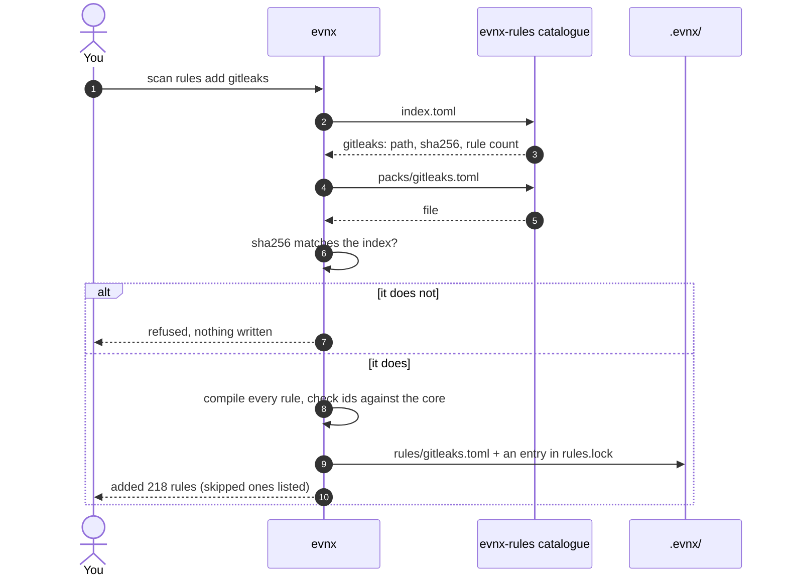

<Callout type="warning" title="Planned for v0.13.0 — not available yet">
Everything on this page past the first section describes **evnx v0.13.0**, which is
being built. The `scan rules` commands, rule files, packs, severity levels, allow
markers and baselines do not exist in any released evnx. Commands shown in grey blocks
below are the design; this page will be checked against the release before it is
published.
</Callout>

## What `evnx scan` uses today

`evnx scan` finds values that look like real credentials: provider tokens with a known
shape (AWS, Stripe, GitHub and others), private keys, URLs with a password in them, and
long random values in variables named like secrets. A project adds its own formats with
`--pattern` or `[[scan.patterns]]` in `.evnx.toml`, and switches a built-in rule off with
`[scan] disable`, which evnx announces on every run.

That works, and v0.13.0 keeps all of it. What it lacks is a way to **share** more rules
than a few patterns, to **reuse** the years of rules other projects have written, and to
say **how bad** a finding is separately from **how sure** evnx is about it.

---

## The three layers

From v0.13.0 every scan builds one rule set from three layers. Each layer can only
**add** rules; none can remove or redefine a rule from a layer below it.



| Layer | Where | Who gets it | Typical use |
|---|---|---|---|
| ① Core | inside the binary | everyone | provider formats evnx vouches for, each with tests |
| ② Project | `.evnx/rules/` in the repository | everyone who clones it, and CI | a pack the team chose; your company's internal token formats |
| ③ Personal | `~/.config/evnx/rules/` | you alone | trying a rule out; your own side projects |
| one run | `--rules <file>` | that run | testing a file before committing it |

**The core is small on purpose.** About sixty rules, each written against the
provider's published token format, each with examples that must match and near misses
that must not. A rule is in the core only when *the provider documents a fixed prefix,
or a fixed length and character set*. Everything wider is opt-in.

**A worked example.** Asha adds a pack to the team's repository and commits `.evnx/`.
Ben pulls; his scans now use it, and so does CI, with nothing downloaded — the files are
in the checkout. Asha also keeps a rule for her side project in her home folder. It
applies only on her laptop, and her scan says so:

```text
Rules: 61 core · 218 project (.evnx/rules: gitleaks) · 1 personal (~/.config/evnx/rules)
```

So when Asha sees a finding CI does not, the header tells her why.

---

## Packs

A **pack** is a rule file someone else wrote, converted to evnx's format, tested, and
published in the [evnx-rules](https://github.com/urwithajit9/evnx-rules) catalogue. You
add one when you want it, and it is pinned from then on.



The lock file records exactly what was added:

```text
# .evnx/rules.lock — written by evnx; commit it with .evnx/rules/
[[pack]]
name   = "gitleaks"
source = "https://raw.githubusercontent.com/urwithajit9/evnx-rules/main/packs/gitleaks.toml"
format = "evnx"
sha256 = "9f3c…"
rules  = 218
added  = "2026-11-14"
```

**Every scan checks it.** A pack file whose bytes no longer match its lock entry is
refused, by name, with exit `2`: a scan that cannot trust its rules gives no verdict
rather than a clean one. Updating is explicit — `scan rules update` shows the old and
new rule counts and the ids added and removed, and asks before replacing anything.
**Nothing updates on its own.**

### Where packs come from

Only rule sets that are plain data with a licence that allows redistribution become
packs. Planned, in order:

| Pack | From | Licence | Rules |
|---|---|---|---|
| `gitleaks` | gitleaks' default configuration | MIT | about 220 |
| `betterleaks` | Betterleaks, the set Kingfisher builds on | MIT | about 470 |
| `noseyparker` | Nosey Parker's rules, with their examples | Apache-2.0 | 87 files |
| `patterns-db` | secrets-patterns-db, an opt-in "large" pack | CC-BY-SA-4.0 | about 1,600 |

TruffleHog's detectors are code under the AGPL, and Semgrep's rules carry a licence that
restricts redistribution, so neither can be a pack. The full list, with each source's
licence and how it may be used, is in the catalogue's
[SOURCES.md](https://github.com/urwithajit9/evnx-rules/blob/main/SOURCES.md).

### Importing a gitleaks file of your own

`scan rules add <file> --format gitleaks` converts a gitleaks configuration on import.
The converted copy is what is stored and locked, so a scan only ever reads evnx's own
format. gitleaks' regexes use Go's RE2 syntax, which is almost the same as Rust's; a
rule that does not compile is **listed and skipped**, never silently dropped. gitleaks
has no severity, so imported rules start at `medium` severity and `medium` confidence.

---

## The planned commands

```text
evnx scan rules list [--json]                      every active rule: id, layer, file, severity, confidence
evnx scan rules new <id> [--personal]              scaffold a rule file with example slots
evnx scan rules test [<file>]                      run each rule against its examples; exit 1 on any failure
evnx scan rules add <name|url|path> [--format evnx|gitleaks] [--personal]
evnx scan rules update [<name>] [-y]               fetch again, show what changed, ask before replacing
evnx scan rules remove <name>
```

And new on `scan` itself:

```text
evnx scan --rules <file>           add a rule file for one run
evnx scan --severity <level>       ⚠️ changes meaning: filters on risk (critical, high, medium, low)
evnx scan --confidence <level>     new: filters on certainty (high, medium, low)
evnx scan --baseline <file>        a baseline other than .evnx/baseline.json
evnx scan --update-baseline        record today's findings as known, exit 0
```

---

## Writing a rule

One format everywhere: the core's own rules, a pack, and a file you write. Examples live
beside the rule, so a rule file tests itself.

```text
# .evnx/rules/acme.toml
version = 1

[[rule]]
id         = "acme-internal-token"          # stable; the id in JSON and SARIF
name       = "ACME internal API token"
regex      = '''\bacme_(live|test)_[A-Za-z0-9]{32}\b'''
keywords   = ["acme_live_", "acme_test_"]   # the regex runs only where one appears
severity   = "high"                         # how bad: critical, high, medium, low
confidence = "high"                         # how sure: high, medium, low
entropy    = 3.5                            # optional minimum randomness of the match
url        = "https://wiki.acme.internal/tokens"

[rule.fixtures]
positive  = ["acme_live_0123456789abcdefABCDEF0123456789"]
near_miss = ["acme_live_short", "acme_prod_0123456789abcdefABCDEF0123456789"]
```

`scan rules test` runs every rule against its `positive` and `near_miss` examples and
reports every failure, not just the first. Never put a live credential in an example:
use the provider's documented example keys, or build a value from the format.

**A rule id that is already taken is an error**, naming both files. A rule file cannot
override a core rule — that would let a downloaded file weaken the scan.

---

## Severity and confidence

Today a finding has one level that mixes two questions. From v0.13.0 they are separate:

| | Answers | Values |
|---|---|---|
| **severity** | How bad is it if this is real? | `critical`, `high`, `medium`, `low` |
| **confidence** | How sure is evnx that it is real? | `high`, `medium`, `low` |

A Google Maps browser key is matched with *high* confidence — the format is
unmistakable — and has *low* severity, because it is meant to be public. A long random
value in `DB_PASSWORD` has *medium* confidence and *critical* severity. A CI gate
usually wants `--severity high`.

⚠️ **This changes `--severity`**, which today filters on confidence, and the JSON gains
`schema_version: 2` with `rule_id`, `severity` and `confidence` on every finding. A
script that reads `confidence` as if it were severity should read `severity`.

---

## Accepting a finding

Some findings are real matches you have decided to keep: a test fixture, a documented
example key. Two ways, both planned for v0.13.0:

**On the line.** A comment on the same line, or the line above, accepts that one rule
there and nowhere else:

```text
STRIPE_KEY=sk_test_example_only_000000   # evnx:allow stripe-secret-key — test fixture
```

A marker without a reason works, and is warned about. There is no marker that silences
every rule on a line. `scan -v` lists everything that was accepted this way.

**Across a repository.** A repository that already has findings records them once:

```text
evnx scan --update-baseline
```

`.evnx/baseline.json` holds a fingerprint per finding — the rule, the file and a hash of
the line's content, so inserting a line above does not break it — and **never a value or
a preview of one**. Findings in it are reported as `known` and do not fail the run; only
new ones do.

---

## What a scan never does

| Never | Because |
|---|---|
| Touch the network | Only `scan rules add` and `scan rules update` download, and only when you run them. A scan in an air-gapped CI job behaves exactly as on your laptop |
| Run code from a pack | A pack is TOML data. Rust's regex engine runs in linear time, so a hostile pattern cannot hang a scan; packs are capped at 2 MB and 5,000 rules |
| Use a pack that changed | `rules.lock` pins each pack's sha256 |
| Let a pack hide a finding | Packs only add rules. Switching one off stays in `.evnx.toml`, which evnx announces |
| Store a secret in a baseline | Fingerprints, rule ids and paths only |

---

## Later: rules.evnx.dev

The catalogue starts as a GitHub repository: free, every change a reviewable pull
request, nothing to deploy. Later it moves to **rules.evnx.dev**, built from the same
repository, with a page per rule — what it matches, its examples, its source and licence
— and a search behind `scan rules search`. The address lives in one setting in evnx, so
the move breaks nothing you have installed: your `rules.lock` records content hashes,
not just addresses.

## See also

- [evnx scan](/guides/commands/scan) — what scanning does today
- [The configuration file](/guides/reference/configuration-file) — `[scan]` settings,
  `[[scan.patterns]]` and `[scan] disable`
- [evnx-rules](https://github.com/urwithajit9/evnx-rules) — the catalogue, its sources
  and how to contribute a pack
